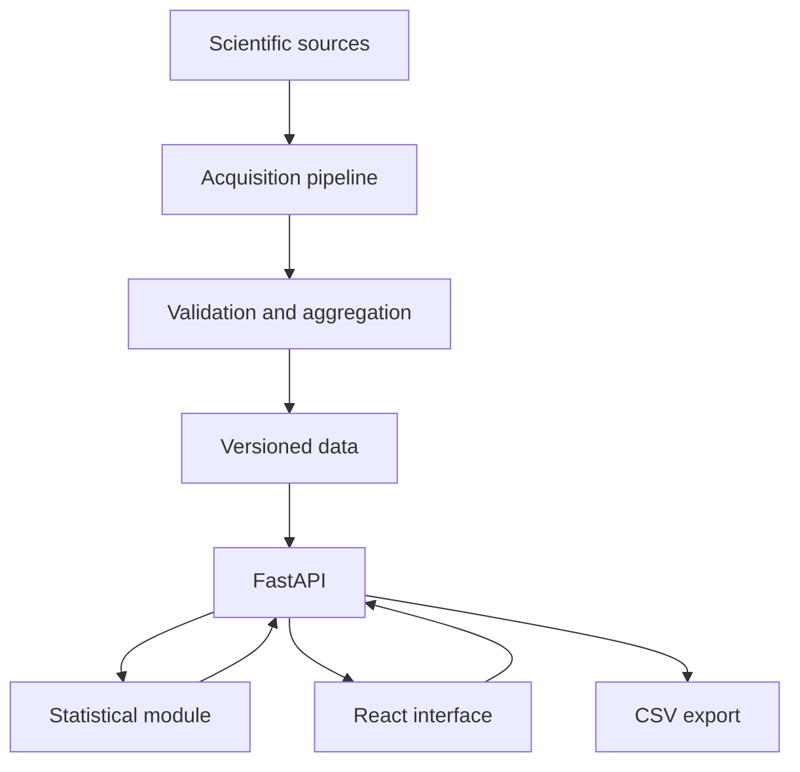

# Earth Detective

Architecture and behavior specification • version 0.3 • 2026-11-14

## 1. Goal

Build a web application for investigating environmental change using scientific data. A user selects a variable, region, and time period and receives a time series, a trend estimate, and an assessment of its statistical significance.

The product should answer four questions:

- What is changing?
- Where is it changing?
- How much is it changing per decade?
- What statistical evidence supports that trend?

The initial audience is students and people with basic scientific knowledge. The interface, messages, and examples are in English.

This document describes a project to be implemented. Data products, versions, coverage, and scientific methods must be validated during implementation. No environmental result presented here is an actual measurement.

## 2. MVP scope

| Feature | Expected behavior |
| --- | --- |
| Catalog | Air temperature, precipitation, and soil moisture; enable each only after verifying availability |
| Region | Select a predefined region from a map or list |
| Period | Choose a period limited to the product's coverage for that region |
| Time series | Monthly chart with units, gaps, and data source |
| Analysis | Trend, rate per decade, confidence interval, and significance when calculable |
| Explanation | Deterministic text based on results and limitations |
| Examples | Two guided investigations using real data |
| Export | CSV containing the time series, metadata, and results |

The initial proposal is to use regions in Ceará or northeastern Brazil. Geographic boundaries must come from an identified, versioned source. User-drawn arbitrary regions, authentication, forecasts, and automatic trend discovery are deferred to later releases.

## 3. Proposed architectural decisions

| Layer | Technology | Purpose |
| --- | --- | --- |
| Interface | React, TypeScript, and Vite | Responsive web application |
| Map | Leaflet and GeoJSON | Select and highlight regions |
| Charts | Apache ECharts | Time series and trends |
| API | Python and FastAPI | Validation, queries, and analyses |
| Contracts | Pydantic and OpenAPI | Typed schemas and documentation |
| Processing | pandas, NumPy, and xarray | Time series and gridded data |
| Statistics | statsmodels and SciPy, subject to method validation | Estimation and inference |
| Processed data | Parquet and a JSON manifest | Fast reads and traceability |
| Tests | pytest, Vitest, and Playwright | Scientific, component, and end-to-end checks |

Dependency versions will be pinned in lockfiles during implementation. The MVP uses versioned files and a bounded in-memory cache. A database may be introduced if user accounts, persistent histories, or operational scale require one.

## 4. Overview



The pipeline runs before a demonstration. It downloads and prepares scientific data, records provenance, and publishes a validated version. The API queries that version locally. Normal user interactions do not require downloading satellite files.

The statistical module is a Python library reusable by both the pipeline and API. Centralizing its implementation avoids discrepancies between precomputed results, the interface, and exports.

## 5. User journey

1. The application loads the variable and region catalogs.
2. The user selects a variable and reads its definition, unit, and limitations.
3. The user selects a region on the map or from the list.
4. The interface checks availability and shows the permitted time range.
5. The user selects a period and requests an analysis.
6. The API validates the request, loads the time series, and runs or retrieves the analysis from cache.
7. The interface presents the chart, trend, data quality, and explanation.
8. The user can change filters, open an example, or export the result.

When filters change, the interface cancels or discards responses to earlier requests. Results remain associated with the filters that produced them. A network error allows the request to be retried without losing the selection.

## 6. Interface layout

| Area | Content |
| --- | --- |
| Header | Project name and access to examples |
| Controls | Variable, region, period, and analysis button |
| Map | Geographic boundaries, active region, and map-source attribution |
| Chart | Dates, unit, observations, and trend corresponding to the analyzed series |
| Results | Direction, rate per decade, interval, and significance |
| Quality | Coverage, gaps, valid observations, and warnings |
| Methodology | Source, version, aggregations, and statistical method |
| Export | Download the current result |

Use a light background, deep blue, supporting green accents, and Inter typography. Significance and direction must also be conveyed through text and symbols. The product must be usable with a keyboard and must not rely on color distinctions alone.

Label the original monthly series and the series used for inference separately. A line computed from annual means must not be presented as a fit to monthly observations without explanation.

## 7. Data and provenance

### 7.1 Candidate sources

| Variable | Candidate source | Checks required before integration |
| --- | --- | --- |
| Air temperature | MERRA-2 | Height or level, unit, grid, version, and coverage |
| Precipitation | GPM | Specific product, rate or accumulation, quality, and coverage |
| Soil moisture | GLDAS | Soil layer, depth, unit, and model configuration |

These are proposed integrations. The data team must consult official documentation and record links, exact identifiers, and access requirements in the manifest. Do not assume that different products have identical coverage.

### 7.2 Pipeline

1. Resolve the product, variable, and period against the validated catalog.
2. Acquire files using server-side credentials when required.
3. Record provenance, acquisition date, version, and checksums.
4. Validate coordinates, calendar, unit, and quality flags.
5. Clip to registered regions and aggregate using documented spatial weights.
6. Convert units and aggregate over time according to physical meaning.
7. Produce a monthly series with coverage and quality indicators.
8. Run checks and publish a complete version atomically.

An interrupted run keeps the previous valid version available. Files being prepared remain in a temporary directory. Re-running with the same inputs and configuration should produce equivalent results.

Use duration-weighted temperature averages when necessary. For precipitation, distinguish rates from accumulations before summing. Preserve the definition of the soil-moisture layer. Missing data remain missing and are never automatically converted to zero.

### 7.3 Record structure

| Field | Meaning |
| --- | --- |
| variable_id | Stable variable identifier |
| region_id | Stable identifier for the region |
| timestamp | Start of the interval in ISO 8601 |
| interval_end | Exclusive end of the interval |
| value | Numeric value or null |
| unit | Measurement unit |
| coverage_fraction | Fraction of valid coverage, from 0 to 1 |
| quality_flags | Quality and gap codes |
| dataset_version | Immutable version of the prepared data |

The manifest includes the original product, official URL, acquisition details, checksum, original unit, conversions, aggregations, geometry and its version, calendar, pipeline configuration, and applicable license or attribution.

GeoJSON uses longitude and latitude, in that order, in WGS 84. The geometry represents the analyzed region. Report the product's spatial resolution to avoid implying municipal-level precision when the data are coarser.

## 8. Statistical strategy

### 8.1 Proposed initial implementation

Display the monthly series and build an annual series for the initial analysis. Use annual means for temperature and soil moisture, and annual accumulation for precipitation after appropriate conversions. Publish only years that satisfy documented coverage criteria for each product. Do not treat partial years as complete.

The initial proposal is linear regression over time, with inference that accounts for autocorrelation—for example, HAC covariance when its assumptions are appropriate. Before enabling significance in the interface, the data team must validate the method, lag selection, and minimum requirements. Short series may remain available for visualization while inference is unavailable.

These choices are a scientific-engineering proposal, not a completed statistical validation.

### 8.2 Calculation and interpretation

Represent time in years and fit `value = intercept + slope × time`. The rate per decade is ten times the annual slope. Scale the slope interval in the same way.

- Record the number of observations and the time span.
- Declare a 95% confidence level and 5% significance level as configured defaults.
- State which hypothesis and method produced the p-value.
- Use the same inference approach for the displayed interval and test.
- Distinguish environmental magnitude from statistical significance.
- Use null and an explicit reason when inference cannot be calculated.
- Handle constant series, extensive gaps, and insufficient observations without numerical errors.

Generate explanations from text templates populated with results, units, and warnings. An inconclusive result should say that the data and method did not provide sufficient evidence to identify a trend at the selected level. It should not claim that no change exists.

Do not rank different variables by their raw slopes because their units differ. Any future scan across many regions must address multiple testing and distinguish exploratory analysis from prespecified hypotheses.

## 9. API contract

Proposed prefix: `/api/v1`. The backend publishes OpenAPI, and the frontend uses types generated from the approved contract.

| Method | Route | Response |
| --- | --- | --- |
| GET | /variables | Catalog with unit, description, and sources |
| GET | /regions | Regions and geometry or GeoJSON reference |
| GET | /availability?variable_id=...&region_id=... | Coverage, gaps, and active version |
| POST | /analyses | Time series and statistical result |
| POST | /analyses/export | CSV for the same filters and versions |
| GET | /health | Basic service availability |

### 9.1 Analysis request

```json
{
  "variable_id": "air_temperature",
  "region_id": "ceara",
  "start_date": "2001-01-01",
  "end_date": "2020-12-31",
  "dataset_version": null
}
```

This example specifies the format only. Real identifiers and dates must come from the catalog. Selected dates are inclusive. The response records the bounds actually used and the eligible complete years. A null version resolves to the active version when the request starts and pins it until the request finishes.

### 9.2 Response structure

| Group | Main fields |
| --- | --- |
| Identification | analysis_id, schema_version, dataset_version, method_version |
| Filters | variable_id, region_id, requested_period, effective_period |
| Provenance | source, product, source_url, retrieved_at, region_version |
| Original series | series with timestamp, value, unit, and quality_flags |
| Analyzed series | analysis_series and aggregation |
| Trend | direction, slope_per_decade, slope_unit, confidence_interval |
| Inference | estimator, inference_method, p_value, alpha, significant |
| Quality | sample_count, expected_count, coverage_fraction, warnings |
| Explanation | summary and limitations |

`significant` may be true, false, or null. `direction` may be increasing, decreasing, stable, or undetermined. The method must define the rule for `stable`; do not automatically round small slopes to indicate no change. Non-finite numbers are not allowed in JSON.

### 9.3 Errors

| HTTP | Use |
| --- | --- |
| 422 | Invalid input, reversed dates, or incompatible period |
| 404 | Unknown variable, region, or version |
| 429 | Request limit exceeded |
| 503 | Dataset or service temporarily unavailable |
| 500 | Unexpected failure with a generic public message |

A valid series with insufficient inference may return 200, with null statistical fields and warnings. Errors include `code`, `message`, and `request_id`. Internal details remain in logs.

### 9.4 Cache and export

The cache key includes normalized filters, data version, geometry, aggregation, method, and statistical parameters. The cache has size and expiration limits. Publishing a new version does not change results associated with previous versions.

Export uses the same filters and versions returned by the analysis. Its CSV uses a tabular format with `record_type` values `observation`, `analysis_observation`, and `summary`, and explicit columns for date, value, unit, and metrics. Include versions and source in the rows so results can be traced outside the application. Document this schema and protect text fields against spreadsheet formula execution.

## 10. Repository structure

| Path | Responsibility |
| --- | --- |
| frontend/src/components/ | Reusable visual components |
| frontend/src/features/exploration/ | Filter, map, and results flow |
| frontend/src/api/ | HTTP client and generated types |
| backend/app/api/ | Routes and validation |
| backend/app/services/ | Orchestration, cache, and export |
| backend/app/repositories/ | Access to prepared data |
| backend/app/science/ | Aggregations and statistical methods |
| pipelines/ | Reproducible acquisition and preparation |
| data/catalog/ | Variables, regions, and manifests |
| data/processed/ | Ready-to-serve series |
| contracts/ | OpenAPI and contract examples |
| tests/science/ | Independent numerical checks |
| tests/integration/ | API and reduced real-data samples |
| tests/e2e/ | Interface journey |
| docs/ | Methodology, operation, and decisions |

Keep large raw files outside Git, with their location and checksum recorded. Clearly identify synthetic test data as fixtures. Supply credentials through environment variables; never include them in the frontend.

## 11. Responsibilities of the seven specialized AI agents

| Workstream | Deliverable | Dependencies |
| --- | --- | --- |
| Repository and integration | Branches, PRs, CI, and release preparation | Deliverables from the six technical workstreams |
| Data | Validated catalog, pipeline, datasets, and scientific module | Product documentation |
| Backend | API, schemas, cache, and export | Contract and data output |
| Frontend | Accessible interface and integration | OpenAPI and examples |
| Security | Review and verified fixes | API, interface, and runtime environment |
| Documentation | Updated technical, scientific, and user guides | Code and evidence from other workstreams |
| Testing | Scientific cases, integration, and complete journey | Contract and runnable versions |

Data and backend define shared schemas first. The frontend may proceed with clearly identified fixtures. Consumers review contract changes. Each workstream reports modified files and validation performed. Security and testing follow implementation and recheck relevant fixes.

## 12. Safeguards and operations

Validate identifiers against the catalog and prevent user-supplied file paths. Public queries access prepared data. External acquisition belongs in the pipeline, with approved destinations and implementation-defined download limits.

Apply request-body, period, concurrency, and processing-time limits. Limit concurrency for expensive queries to avoid blocking the server. Configure CORS for deployment domains and keep credentials server-side.

Log `request_id`, duration, versions, normalized filters, and error category. Keep secrets out of logs. Pin dependencies and check applicable vulnerabilities. Published infrastructure must provide HTTPS.

## 13. Tests and acceptance criteria

| Area | Check |
| --- | --- |
| Science | Known trends, constant series, fixed-seed noise, and insufficient data |
| Inference | Comparison with independent calculation and behavior under autocorrelation |
| Units | Rate versus accumulation and months of different durations |
| Quality | Gaps, incomplete years, flags, and no conversion to zero |
| Contract | Types, null values, errors, versions, and units |
| Interface | Keyboard, mobile, loading, failures, and rapid filter changes |
| Integration | API with a small, versioned real-data sample |
| Export | Same values, filters, and versions as the interface |
| Security | Limits, malformed input, paths, and CSV |

The MVP is ready when a user can complete the journey with real data, understand the unit and trend, review limitations, and export a reproducible result. Both examples must work in the demonstration environment. Features that depend on mocks remain marked as pending.

## 14. Proposed deployment

Serve the static frontend build and Python API, preferably from the same origin, routing `/api` to the backend. Make prepared data available on a read-only volume. Run the pipeline in a separate environment and publish approved versions.

For development, run Vite and FastAPI separately with a local proxy. Document definitive commands once dependency files exist. This specification does not assume that scripts or infrastructure have already been created.

The MVP may use a single API process with a bounded cache. Scaling to multiple replicas requires reviewing the cache, global limits, and consistent version publication. Reserve task queues for future analyses that exceed normal request times.

## 15. Implementation sequence

1. Validate one product, one variable, and two regions with real data.
2. Define the catalog, manifest, and initial contract.
3. Build the pipeline and validate the series and methodology.
4. Deliver analysis and export through the API.
5. Integrate the map, filters, and chart with the backend.
6. Add the remaining approved variables.
7. Prepare guided examples and explanatory text.
8. Run a security review and end-to-end tests.
9. Pin data and dependency versions for the demonstration.

## 16. Open decisions

- Products, versions, time coverage, and credentials required by the sources.
- Source and exact extent of geographic boundaries.
- Quality criteria and minimum observation counts for each method.
- Validation of regression and inference under autocorrelation.
- Map provider, attribution, and availability during the presentation.
- Hosting environment and measured computational limits.

Record these decisions as implementation progresses. The central workflow, contracts, and separation of responsibilities defined here guide the seven workstreams.

## 17. Repository management and integration

The repository-management AI coordinates the development workflow and integrates data, backend, frontend, security, and testing deliverables. Start by inspecting the repository, existing changes, remotes, and local instructions.

### Proposed workflow

1. Keep `main` as the integrated reference and create short task branches such as `feat/data-catalog`, `feat/analysis-api`, and `fix/csv-export`.
2. Use separate worktrees when agents work simultaneously in the same repository. Avoid switching the branch of a directory another workstream is using.
3. Track tasks with an owner, dependencies, affected files, and acceptance criteria.
4. Integrate contracts and the catalog first, then the scientific module and API, followed by the frontend. Security and testing accompany every stage.
5. Review each diff and run relevant checks before integration. Revalidate the combined result after resolving conflicts.
6. Keep commits cohesive and PRs clear about behavior, validation, and limitations.
7. Prepare a demonstrable version identified by commit, `dataset_version`, and `method_version`.

The repository manager tracks changes to `contracts/`, dependency files, and shared configuration to prevent incompatible concurrent edits. Resolve conflicts involving scientific meaning with the data workstream; involve backend and frontend when contracts change.

### Proposed continuous integration

| Check | When |
| --- | --- |
| Frontend type checking and build | PRs that change the interface or contract |
| Backend and contract tests | PRs that change the API, schemas, or methods |
| Deterministic scientific tests | Changes to data, aggregations, or methodology |
| End-to-end tests | Integration and demonstration preparation |
| Dependency and secret checks | Configuration in collaboration with security |

CI uses small, identified fixtures. Tests that use remote sources or extensive data run separately and report results explicitly. Use the existing remote's platform for configuration. For GitHub, workflows belong in `.github/workflows/`.

The repository manager preserves third-party changes and respects existing permissions for pushes and merges. Publication, remote branch deletion, and history rewriting require authorization within the current scope. Report an access blocker with the exact pending action.

### Repository-manager AI prompt

You are responsible for the Earth Detective repository and integration. Use this document as a reference and inspect the project's actual state before acting.

Organize and integrate the work of the six technical workstreams. Identify branches, local changes, shared contracts, task dependencies, and available checks. Preserve existing work.

Create task branches and use worktrees for concurrent work. Maintain a concise record of deliverables, owners, dependencies, status, and acceptance criteria. Coordinate changes to contracts and shared files.

Prepare cohesive commits and PRs. Review diffs, resolve conflicts while preserving agreed behavior, and run checks against the integrated result. Refer methodology questions to the data workstream and contract incompatibilities to backend and frontend.

Configure CI proportionally to the project and its existing platform. Include the build, type checking, relevant tests, and checks agreed with security. Separately report checks that require network access, credentials, or real data.

Integrate deliverables within existing authorization and prepare a demonstrable version with its commit, data and method versions, verified run instructions, and known limitations. If remote access is unavailable, continue the possible local work and report the pending operation.

At completion, report branch and PR status, integrated changes, tests run, conflicts resolved, and concrete remaining work. Only declare an integration validated when there is evidence that its checks ran.

## 18. Documentation and team composition

The team comprises eight agents: the orchestrator and seven specialized roles. As deliverables become available, the documentation AI maintains the README, architecture, methodology, user guide, development instructions, demonstration script, and release notes. It verifies commands and examples and records pending work. The data workstream reviews scientific explanations. The full prompt is in `EARTH_DETECTIVE_DOCUMENTATION_AI.md` and the prompt collection.

